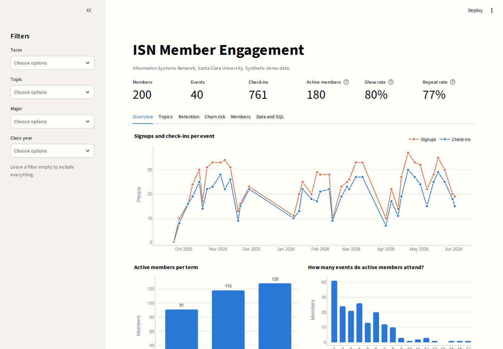
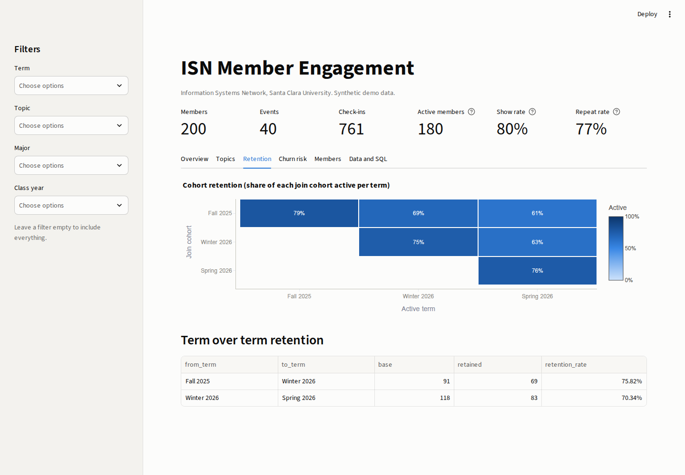
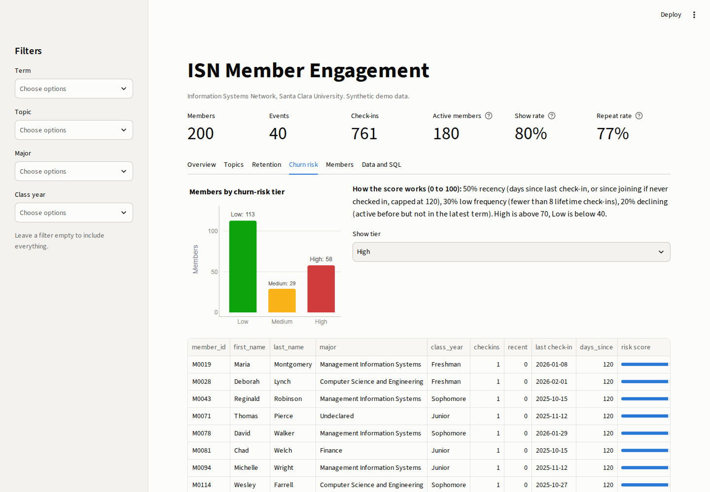

# ISN Engagement Dashboard


Member engagement analytics for the **Information Systems Network (ISN)** at Santa Clara
University. A small but complete analytics stack: a Python ETL that turns messy event
signup and check-in exports into a clean SQLite star schema, a data quality report, a
metrics layer, SQL queries, and an interactive Streamlit + Plotly dashboard.

> All data in this repo is synthetic (generated with Faker). No real members are included.



## The problem

As Co-President of ISN, I kept running into the same questions after every quarter:

- Are more people actually showing up, or just signing up?
- Which workshop topics are worth repeating?
- Are the members who joined in Fall still coming back in Spring?
- Who has quietly stopped attending, so we can reach out before they are gone?

Our data lived in separate CSV exports from the signup form and the check-in sheet, with
the usual problems: duplicate rows, inconsistent casing, blank majors, a mix of date
formats, and check-ins for people or events that do not exist. Answering any of these
questions meant an afternoon of spreadsheet cleanup. This project automates that pipeline
end to end and puts the answers on one dashboard.

## Features

**ETL with a data quality step** (`src/isn_engagement/etl.py`)
- Validates that each export has the required columns and fails with a clear message if not
- Normalizes emails, names, class years, topics, and five spellings of yes/no
- Parses mixed date formats, nulls out impossible room capacities, removes duplicates
- Drops orphan check-ins (unknown member or event) instead of silently loading them
- Writes a Markdown **data quality report** counting every fix and every dropped row
- Loads a SQLite **star schema** in one transaction, so a failed load never leaves half a database

**Metrics** (`src/isn_engagement/metrics.py`)
- Attendance trend per event: signups, check-ins, show rate
- Term summary: events, check-ins, distinct active members, average turnout
- Repeat-attendance rate and the distribution of events attended per member
- Workshop popularity by topic: turnout, show rate, fill rate against room capacity
- Cohort retention matrix (join term x active term) and term-over-term retention
- Churn risk score (0 to 100) with Low / Medium / High tiers and a downloadable outreach list
- Breakdowns by major and class year

**Dashboard** (`app.py`)
- KPI row plus six tabs: Overview, Topics, Retention, Churn risk, Members, Data and SQL
- Sidebar filters for term, topic, major, and class year that apply to every chart
- Hover tooltips on every chart, tables behind every chart, CSV export of at-risk members
- Builds its own database on first launch, so `streamlit run app.py` just works

**SQL** (`sql/`)
- `schema.sql` plus six analysis queries (term attendance, cohort retention, repeat rate,
  topic popularity, major/year breakdown, churn watchlist) that can be run in any SQLite
  client. Tests check that the SQL and pandas versions of each metric agree.

| Retention | Churn risk |
|---|---|
|  |  |

## Architecture

```
data/raw/*.csv  ──>  etl.py  ──>  data/isn.db (SQLite star schema)  ──>  metrics.py  ──>  charts.py  ──>  app.py
 (signup and        extract           dim_members                        pure pandas      Plotly         Streamlit
  check-in          clean + report    dim_events                         functions        figures        layout and
  exports)          load              fact_attendance                                                    filters only
                       │
                       └──>  data/quality_report.md
```

```
├── app.py                     Streamlit UI (no business logic)
├── sql/                       schema + analysis queries
├── src/isn_engagement/
│   ├── seed.py                synthetic, intentionally messy CSV generator
│   ├── etl.py                 extract, clean, quality report, load
│   ├── db.py                  SQLite access layer
│   ├── metrics.py             all engagement metrics
│   ├── charts.py              Plotly figure builders
│   ├── terms.py               SCU quarter helpers
│   └── bootstrap.py           build the DB on first run
└── tests/                     pytest suite, including Streamlit AppTest
```

**Star schema.** `fact_attendance` holds one row per member per event (signup timestamp and
a checked-in flag). It joins to `dim_members` (major, class year, join term) and
`dim_events` (topic, type, date, term, capacity). Foreign keys and CHECK constraints are
enforced in SQLite, so bad data cannot slip in after the ETL.

**Design choices.**
- Logic lives in plain functions that take and return DataFrames. The Streamlit file only
  wires widgets to those functions, which is what makes the metrics unit testable.
- Terms follow the SCU quarter calendar (Fall, Winter, Spring). The seed covers three
  quarters: Fall 2025, Winter 2026, Spring 2026.
- The churn score is deliberately simple and explainable so a student board can act on it:
  50% recency (days since last check-in, capped at 120), 30% low frequency, 20% declining
  (active before but not this term). New members are measured from their join date so they
  are not flagged on day one.
- Charts use a colorblind-validated palette, one shared axis per chart, and status colors
  that always come with a text label.

## Run it

Requires Python 3.12.

```bash
git clone https://github.com/RSChannagiri/isn-engagement-dashboard.git
cd isn-engagement-dashboard
python3.12 -m venv .venv && source .venv/bin/activate
pip install -r requirements.txt && pip install -e . --no-deps

streamlit run app.py          # builds data/isn.db on first launch
```

Or run each step yourself:

```bash
python -m isn_engagement.seed --out data/raw --members 200 --events 40   # regenerate exports
python -m isn_engagement.etl --raw data/raw --db data/isn.db             # clean, report, load
sqlite3 data/isn.db < sql/topic_popularity.sql                           # ad hoc SQL
```

A `Makefile` wraps these as `make setup`, `make seed`, `make etl`, `make app`, `make test`,
and `make lint`. To point the dashboard at a different database, set `ISN_DB_PATH` (and
`ISN_RAW_DIR` for the raw exports).

## Test

```bash
pytest          # 100+ tests
ruff check . && ruff format --check .
```

The suite covers term boundaries, the seed generator (determinism, no check-ins before a
member joined), every cleaning rule in the ETL, database constraints and transactional
reloads, every SQL query (and that SQL matches pandas), each metric on a small hand-checked
dataset plus edge cases (empty data, unknown columns, out-of-range scores), chart builders,
and Streamlit `AppTest` smoke tests that click through filters and selectors.

## Tech stack

Python 3.12, pandas, SQLite, SQL, Streamlit, Plotly, Faker, pytest, ruff, GitHub Actions.

## What I learned

- **Data quality is the real product.** Most of the work was deciding what to do with bad
  rows: fix, fill, or drop, and how to make that visible. The quality report turned
  "trust me, it is clean" into a table anyone on the board can read.
- **Define the metric before building the chart.** "Engagement" meant different things to
  different officers. Writing each one down as a function with a test (show rate, repeat
  rate, retention, churn risk) forced us to agree on definitions.
- **Star schemas make questions cheap.** Once attendance was a fact table with clean
  dimensions, new questions were a short SQL query instead of a new spreadsheet.
- **Separate logic from UI.** Keeping Streamlit thin meant I could test the numbers
  without a browser and swap the front end later without rewriting the analysis.
- **Explainable beats clever for small orgs.** A weighted churn score that a student
  leader can understand and act on is more useful than a black-box model on 200 members.
- **Tests catch real bugs.** A rollback test showed that pandas `to_sql` commits on its own,
  which meant a failed reload could wipe the database. Switching to a single explicit
  transaction fixed it.

## License

MIT. See [LICENSE](LICENSE).
